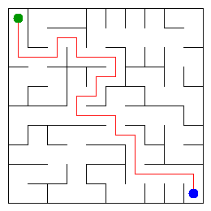

# Assignment 3. Maze Escape

Student ID: 251427
Name: Dayana Orynbassarova  
Group: SE-2510
Maze size (rows x columns): 10 x 10

This project implements algorithms for building and solving a maze, finding strongly connected zones in a directed graph, and calculating routes between zones.
## Program output

Output from (`java -cp out Main`):

    Broken: 99
    Kept: 81
    Last broken wall: 153
    MST cost: 26837
    Heaviest broken wall: 729
    Path length: 24
    DFS visited: 61
    Dead ends: 32
    Zones: 11
    Largest zone: 19
    Is DAG: 0
    Flow stages: 4
    Fastest route cost: 3  

My maze:

## Questions

Answer in your own words, two or three sentences each.

Mission 0. What do find and union do, and what makes them fast in your code?
"Find" returns the root of a set, and "union" joins two sets. Path compression and union by size make these operations efficient.

Mission 1. Why is Broken always R*C - 1, and Kept always (R-1)*(C-1)?
A maze must connect all RC cells without cycles, so it needs RC - 1 broken walls. The remaining walls are kept: (R - 1)*(C - 1).

Mission 2. My MST cost from Kruskal and from Prim, and why they are equal:
Both algorithms find a minimum spanning tree, so their total costs are equal. For my data, the MST cost is 26837.

Mission 3. Why is there exactly one path between two cells? How did you avoid a stack overflow on a huge maze?
The maze is a spanning tree, so there is exactly one path between any two cells. I used an iterative DFS using an array-based stack instead of recursion.

Mission 4. Why does the second pass of Kosaraju go on the reversed graph? Why do the slides have no cycle exactly when Zones equals the number of cells?
The reversed graph helps Kosaraju find strongly connected components. The graph has no directed cycle if every zone contains exactly one cell.

Mission 5. Why is it enough to go through the zones in the order of their numbers? What does this pass cost?
The zones are numbered in topological order, so each edge between zones goes from a smaller number to a larger one. My implementation processes every zone and scans all slides, taking O(Z*M) time. 

## AI use
I used ChatGPT to understand the assignment and algorithms, get help with implementation and debugging, and review test results. I also used it to help write this report. I tested my code using the provided checker and example data.

## Timing (Mission 7)

Measurements in milliseconds using 5 runs each from `java -cp out Bench`.

| maze | Kruskal | Prim |
|---|---|---|
| 100 x 100 | 42 | 535 |
| 300 x 300 | 173 | 39011 |
| 1000 x 1000 | - | - |

What do the numbers say about how the time grows? Two or three sentences.
Complete this answer after collecting the measurements. Kruskal sorts the walls, while my Prim implementation scans al walls for each cell.
The measurements will show how these different approaches affect running time as the maze grows.
The 1000 x 1000 measurement did not finish during my test.

## Complexity

N is the number of cells, M is the number of walls (or slides), Z is the number of zones.

| algorithm | time | space | assumptions |
|---|---|---|---|
| DSU find and union | O(α(N)) | O(N) | Path compression, union by size |
| Kruskal | O(M log M + N α(N)) | O(M + N) | Sorted walls |
| Prim | O(N² + N*M) | O(N) | Scans all walls for each cell |
| DFS | O(N) | O(N) | Grid with at most 4 neighbours |
| Kosaraju | O(N + M) | O(N + M) | Graph and reverse graph |
| Route in the zone graph | O(Z*M) | O(Z) auxiliary | Topological order |

## Before you submit

- data/walls.txt, data/slides.txt and output/maze.png are in the repository.
- `java tools/Check.java` shows all examples right.
- This README is filled in, the program output and the section AI use included.
- The work is pushed to main (at least one commit per mission) and the repository is public.
- The link is attached in Moodle.
